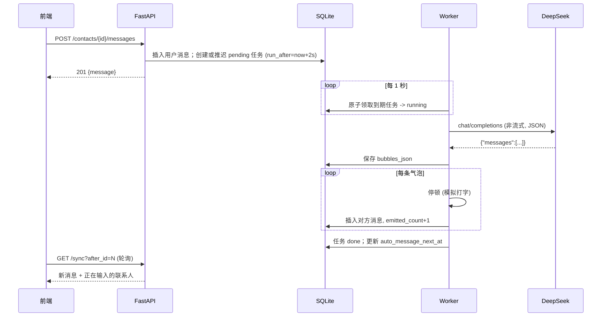

# V2 设计：服务端回复流水线 + 增量同步 + PWA + 小记忆系统

> 范围：服务端自动发消息、打开页面增量拉取、PWA、隐藏流式过程并显示「对方正在输入…」、模型可切换（V4.1 Flash / deepseek-chat）、多气泡协议加固、性能优化、小记忆系统（含用户可见的记忆总结）。
> 对应 SQL：`AI_FILES/sql/v2_reply_jobs.sql`、`AI_FILES/sql/v2_memory.sql`

---

## 1. 目标与非目标

### 目标（验收口径）

| # | 目标 | 验收标准 |
|---|------|----------|
| G1 | 自动发消息在服务端执行 | 关闭所有浏览器页面后，到间隔时间数据库仍新增对方消息；重新打开页面能看到 |
| G2 | 增量拉取 | 打开页面后，只拉取 `id > 本地最大 id` 的新消息；不再在每次回复后全量重拉消息和联系人 |
| G3 | PWA | 手机浏览器可「添加到主屏幕」，独立窗口打开；断网时能打开应用外壳并提示离线 |
| G4 | 隐藏流式、显示「正在输入…」 | 不再出现逐字打印；回复生成期间聊天页标题显示「对方正在输入…」，气泡按条出现 |
| G5 | 模型可切换 | 每个联系人可在编辑资料里选择「V4.1 Flash」或「deepseek-chat」，调用实际使用对应模型 |
| G6 | 多气泡协议可靠 | 模型输出格式异常时有确定的兜底；单次回复 1～4 条；不会出现分隔符漏到气泡里 |
| G7 | 性能 | 单会话 5000 条消息时，打开会话首屏 < 300ms（本地）、只渲染最近 50 条，上滑分页加载 |
| G8 | 记忆 | 早于最近 50 条上下文的事情（如「我的猫叫团子」），之后问起时对方能答对 |
| G9 | 记忆对用户可见 | 联系人详情页可查看「Ta 记得的事」：一段角色口吻的总结 + 可编辑、可删除、可置顶的记忆列表 |

### 非目标（本期不做）

- Web Push 推送通知（PWA 后续可加，但需要 VAPID 与订阅管理，单独立项）
- 多用户 / 登录鉴权（仍为单机单用户；但见 §10 风险）
- WebSocket 实时通道（本期用轮询，见 §3.2 取舍）
- 向量检索 / 知识图谱记忆（DeepSeek 没有 embedding 接口，见 §7.1）
- 跨联系人共享记忆（每个联系人的记忆相互独立）

---

## 2. 现状与问题

当前链路：前端 `POST /chat/stream` → 后端在 SSE 响应里调用 DeepSeek 流式接口 → 边解析 `§` 边推 `delta` → 前端逐字渲染 → `done` 后前端**全量**重拉联系人列表和消息列表。

自动发消息：前端 `useAutoMessageScheduler` 每 30 秒轮询，页面关闭即停止。

### 2.1 与本期需求冲突的设计

1. **回复生成绑定在 HTTP 请求上**：页面关闭或网络断开，SSE 中断；部署重启容器时正在生成的回复直接丢失。
2. **自动消息依赖前端定时器**（`frontend/src/composables/useAutoMessageScheduler.js`），无法满足 G1。
3. **每轮回复后全量刷新**（`stores/chat.js` 的 `onDone` 调用 `fetchContacts` + `fetchMessages`），会话越长越慢。
4. **模型写死**：`config.py` 中 `deepseek_model = "deepseek-chat"`，全局唯一。

### 2.2 顺带发现的现有缺陷（Phase 0 修复）

| 缺陷 | 位置 | 影响 |
|------|------|------|
| 上下文取的是**最早**的 50 条而不是最近 50 条 | `routers/chat.py`：`order_by(created_at.asc()).limit(50)`（三处） | 聊天超过 50 条后，模型看不到最近的对话，回复会"失忆" |
| 第一个对方气泡被插入两次 | `stores/chat.js` `_runStream`：`appendAssistantBubble()` 已 push，又 `[...messages, userBubble, assistantBubbles[0]]` | 流式期间出现一个空的「…」气泡且排在用户消息前，同一对象重复 key |
| 调用失败的 `[错误] xxx` 被存成对方消息 | `_assistant_event_stream` 的 `error_text` 分支 | 错误文本进入后续上下文，污染模型输入；列表摘要显示为错误 |
| `messages` 表没有 `contact_id` 索引 | `models.py` | 按会话查询、列表取最后一条消息都是全表扫描 |

---

## 3. 关键设计决策

### 3.1 回复改为「任务 + 后台 Worker」，统一用户触发与自动触发

**决策**：用户发消息只负责落库并创建一条回复任务（`reply_jobs`），立即返回；后台 Worker 领取任务、调用模型、按条写入气泡。自动发消息也是创建同一种任务（`trigger='auto'`）。

理由：
- 隐藏流式之后，前端不再需要和模型生成过程保持长连接，生成可以完全脱离请求。
- 一条流水线同时满足 G1（服务端自动消息）、G4（正在输入状态 = 存在运行中的任务）、页面关闭不丢回复、部署重启可恢复。
- 任务表让失败可见（`status='failed'` + `error`），而不是写一条假的对方消息。

**放在哪里运行**：FastAPI `lifespan` 中启动一个 asyncio 后台循环，与 API 同进程。

| 方案 | 优点 | 缺点 | 结论 |
|------|------|------|------|
| 同进程 asyncio 循环 | 零新增依赖、零新增容器，和现有单 uvicorn worker 一致 | 多 worker 时会重复执行 | **采用**；用数据库原子领取防重复（见 §5.2） |
| APScheduler | 现成的定时语义 | 新依赖，仍需自己防重复 | 不采用，需求只要 1 秒级轮询 |
| 独立 worker 容器 | 与 API 隔离 | SQLite 跨容器写入锁竞争、部署更复杂 | 暂不采用；换 PostgreSQL 后再考虑 |

### 3.2 增量同步用「自适应短轮询」，不用 SSE / WebSocket

**决策**：前端调用 `GET /api/sync?after_id=N`，按状态调整间隔。

| 状态 | 轮询间隔 |
|------|----------|
| 有联系人正在输入，或自己刚发出消息 | 1.5 秒 |
| 前台空闲 | 10 秒 |
| 页面隐藏（`document.hidden`） | 暂停 |
| 页面重新可见 / 网络恢复（`online`） | 立即同步一次 |

理由：
- 消息是按条整块写入的，1.5 秒延迟对聊天体验足够。
- 手机 PWA 切后台会被系统挂起，长连接本来就会断，轮询天然可恢复。
- 宿主 Nginx 无需额外配置长连接超时。
- 游标用消息自增 `id`（单调递增、主键索引），比时间戳可靠。

后续若需要更低延迟，可把 `/api/sync` 换成 SSE 事件通道，接口返回结构不变。

### 3.3 多气泡协议：主用 JSON 输出，`§` 分隔符兜底

**决策**：既然流式过程已隐藏，就不再需要边生成边切分，改为一次性拿到完整结果后再解析。

1. **主路径**：使用 DeepSeek JSON Output（`response_format: {"type": "json_object"}`），要求输出：
   ```json
   {"messages": ["第一条", "第二条"]}
   ```
2. **兜底链**（确定性代码，按顺序尝试，第一个成功即用）：
   1. 解析 JSON，取 `messages` 字符串数组；
   2. 去掉 ```` ```json ```` 代码围栏后再解析；
   3. 按单独一行的 `§` 切分；
   4. 按空行切分；
   5. 整段作为 1 条。
3. **规范化**：去空白、去空条；超过 4 条时把第 4 条及之后合并为第 4 条（不丢内容）；单条超过 500 字时保持原样（不硬切句子）。
4. **结果全为空**：视为失败，任务重试 1 次，仍为空则 `failed`。

取舍：JSON 模式需要等完整输出才能发出第一条气泡，首条延迟比流式切分略高；但回复本身是 1～4 条短句，生成时间短，且后面还有模拟打字的停顿，用户感知差异很小，换来的是格式稳定。DeepSeek JSON 模式要求提示词里出现 "json" 字样并给出示例，否则可能返回空内容，这一点写进 system prompt。

### 3.4 模拟真人节奏

- **合并连发**：用户发消息后，任务的 `run_after = now + 2 秒`；2 秒内用户继续发，则把同一个待执行任务的 `run_after` 往后推。效果是用户连发几条，对方读完一起回，而不是每条各回一次。
- **逐条释放**：Worker 拿到气泡数组后，每条之前停顿 `clamp(400ms + 字数 × 60ms, 800ms, 4000ms)`，然后写入一条消息并提交。前端轮询期间看到「正在输入…」，气泡一条一条出现。

### 3.5 模型切换按联系人配置

**决策**：联系人新增字段 `model_profile`，取值 `flash` / `chat`，默认 `flash`。档位到实际请求参数的映射集中在后端配置里，一处维护：

| 档位 | 页面显示 | 请求参数 |
|------|----------|----------|
| `flash` | V4.1 Flash（推荐） | `model: "deepseek-flash"`，`thinking: {"type": "disabled"}` |
| `chat` | deepseek-chat | `model: "deepseek-chat"` |

说明：
- 按联系人而不是全局：每个联系人本来就有独立的 API Key，按联系人切换最自然。
- `flash` 关闭思考模式：即时聊天要的是低延迟，思考模式会明显变慢且多计费。
- **需要先确认**：联网资料显示 `deepseek-chat` 旧名称已于 2026-07-24 退役，部分资料称调用会报错，另一部分称会路由到 V4.1 Flash 非思考模式，说法不一致。实施第一步用真实 Key 调 `GET https://api.deepseek.com/models` 和一次最小对话验证。
  - 如果 `deepseek-chat` 已不可用：**不做静默降级**，编辑页把该选项标为「已停用」，调用失败时任务 `failed` 并在聊天页显示原因。

### 3.6 PWA

- 引入 `vite-plugin-pwa`（Workbox）。
- Service Worker **只缓存应用外壳**（HTML / JS / CSS / 图标），`/api/*` 一律 `NetworkOnly`，`/uploads/*` 用 `CacheFirst` 且限制条数（头像、背景图）。
- Manifest：名称「聊天」、`display: standalone`、主题色 `#ededed`、192/512 图标（需要新出 PNG 图标，现在只有 SVG 默认头像）。
- 更新策略：`registerType: 'prompt'`，有新版本时页面底部提示「有新版本，点击刷新」，避免部署后用户一直停留在旧缓存。
- **前置条件**：Service Worker 只能在 HTTPS（或 localhost）下注册。线上 `chat.linluo.site` 目前是 HTTP，**必须先配置 HTTPS**（certbot），否则 PWA 在线上不生效。

---

## 4. 数据模型变更

完整 DDL 见 `AI_FILES/sql/v2_reply_jobs.sql`；启动迁移沿用 `services/migrate.py` 的「检查列是否存在再 `ALTER`」方式。

### 4.1 新表：`reply_jobs`（【聊天】回复任务表）

| 字段 | 类型 | 说明 |
|------|------|------|
| `id` | INTEGER PK | 任务 ID |
| `contact_id` | INTEGER FK | 联系人 ID |
| `trigger` | VARCHAR(16) | 触发来源：`user` / `auto` |
| `status` | VARCHAR(16) | `pending` / `running` / `done` / `failed` |
| `run_after` | DATETIME | 最早执行时间（用于合并连发） |
| `attempts` | INTEGER | 已尝试次数 |
| `bubbles_json` | TEXT | 模型返回并解析后的气泡数组（JSON） |
| `emitted_count` | INTEGER | 已写入消息表的气泡数（断点续发） |
| `error` | VARCHAR(512) | 失败原因（展示给用户） |
| `created_at` / `updated_at` | DATETIME | 时间戳 |

索引：`(status, run_after)` 用于领取；`(contact_id, status)` 用于判断是否正在输入。

### 4.2 `contacts` 新增字段

| 字段 | 类型 | 说明 |
|------|------|------|
| `model_profile` | VARCHAR(16) 默认 `flash` | 模型档位 |
| `auto_message_next_at` | DATETIME | 下次自动发消息时间（服务端调度用） |
| `auto_message_streak` | INTEGER 默认 0 | 用户未回复期间已连续自动发送的条数 |

保留 `auto_message_enabled`、`auto_message_interval_minutes`、`auto_message_last_at`。

### 4.3 `messages` 新增索引

- `ix_messages_contact_id_id (contact_id, id)`：会话分页、取最后一条消息。

### 4.4 SQLite 设置

连接时开启 `PRAGMA journal_mode=WAL` 和 `PRAGMA busy_timeout=5000`。Worker 与 API 请求会并发写库，WAL 允许读写并发，`busy_timeout` 避免偶发 `database is locked`。

### 4.5 记忆相关

新表 `memories`（【记忆】记忆条目表）、`memory_states`（【记忆】联系人记忆状态表），`contacts` 新增 `memory_enabled`。字段说明见 §7.6，DDL 见 `AI_FILES/sql/v2_memory.sql`。

---

## 5. 服务端设计

### 5.1 回复流水线时序



### 5.2 Worker 循环（`app/services/reply_worker.py`）

每 1 秒执行一次：

1. **领取任务**：原子更新，保证同一任务只被一个执行者拿到。
   ```sql
   UPDATE reply_jobs SET status='running', attempts=attempts+1, updated_at=:now
   WHERE id = (
     SELECT j.id FROM reply_jobs j
     WHERE j.status='pending' AND j.run_after <= :now
       AND NOT EXISTS (SELECT 1 FROM reply_jobs r WHERE r.contact_id=j.contact_id AND r.status='running')
     ORDER BY j.run_after, j.id LIMIT 1
   ) AND status='pending'
   RETURNING id;
   ```
   同一联系人同时最多一个运行中任务；全局并发上限 2（`asyncio.Semaphore`）。
2. **执行任务**：
   - `bubbles_json` 为空：组装上下文（**最近** 50 条，`ORDER BY id DESC LIMIT 50` 后反转）→ 调用模型 → 解析气泡 → 存入 `bubbles_json`。
   - 从 `emitted_count` 开始逐条停顿、写消息、`emitted_count+1`、提交。
   - 完成后 `status='done'`。
3. **失败处理**（确定性代码，不靠模型）：
   - 429 / 5xx / 超时：`attempts < 2` 时退回 `pending`，`run_after = now + 5s × attempts`；否则 `failed`。
   - 4xx（Key 无效、模型不存在）：直接 `failed`，`error` 写入可读原因（如「API Key 无效」「模型 deepseek-chat 已停用」）。
   - 失败**不再**写入对方消息。
4. **启动恢复**：服务启动时把 `running` 任务改回 `pending`。由于有 `bubbles_json` 和 `emitted_count`，恢复后从断点继续发剩余气泡，不会重复调用模型，也不会重复发已写入的气泡。

### 5.3 自动发消息调度（同一循环，每 30 秒检查一次）

条件：`auto_message_enabled = 1` 且 `auto_message_next_at <= now` 且该联系人没有 `pending/running` 任务。

动作：创建 `trigger='auto'` 的任务，并把 `auto_message_next_at` 设为 `now + 间隔`（先占位，避免下一轮重复创建）。

计时规则：
- 开启开关或修改间隔时：`next_at = now + 间隔`。
- 任意一方发出消息后：`next_at = 该消息时间 + 间隔`。即「双方都安静满间隔才主动说话」，更像真人。
- **连续上限**：用户一直不回复时，`auto_message_streak` 达到 3 后暂停自动发送，用户回复一条后清零。这是成本上限，也避免对方无休止自言自语；上限值放配置，默认 3。

### 5.4 API 变更

| 方法 | 路径 | 说明 |
|------|------|------|
| POST | `/api/contacts/{id}/messages` | 发文本，body `{content}`；返回 201 + 用户消息 |
| POST | `/api/contacts/{id}/messages/file` | 发图片/文件；返回 201 + 用户消息 |
| GET | `/api/contacts/{id}/messages?before_id=&limit=50` | 历史分页，按 `id` 倒序取、正序返回，附 `has_more` |
| GET | `/api/sync?after_id=` | 增量同步（见下） |
| POST | `/api/jobs/{id}/retry` | 重试失败任务（重新排队） |
| PATCH | `/api/contacts/{id}` | 新增可选字段 `model_profile` |
| GET | `/api/models` | 返回可选档位与显示名（前端下拉框使用） |
| — | `/api/contacts/{id}/memories` 等 | 记忆相关接口，见 §7.7 |

**删除**：`/chat/stream`、`/chat/file/stream`、`/chat/auto/stream` 三个 SSE 接口，以及 `im_reply.py` 中的流式切分逻辑。单用户、前后端同时发布，不保留兼容期。

`GET /api/sync` 返回结构：

```json
{
  "messages": [ /* id > after_id 的新消息，跨所有联系人，按 id 升序，最多 200 条 */ ],
  "has_more": false,
  "typing_contact_ids": [3],
  "contacts": [ /* 本次有新消息的联系人列表项（含最新摘要、时间） */ ],
  "failed_jobs": [ { "id": 12, "contact_id": 3, "error": "API Key 无效" } ],
  "server_time": "2026-10-20T08:00:00Z"
}
```

- `typing_contact_ids`：存在 `running` 任务，或 `pending` 且 `run_after` 已到期的联系人。用户刚发消息、处于 2 秒合并等待期时**不**显示正在输入，更像真人「已读后才开始打字」。
- `failed_jobs`：最近 24 小时内、未被重试的失败任务。
- `has_more=true` 时前端立即再拉一次，直到追平。

### 5.5 模块划分

| 文件 | 职责 |
|------|------|
| `app/services/llm_profiles.py` | 档位 → 请求参数映射；显示名 |
| `app/services/deepseek.py` | 新增非流式 `chat_completion()`，支持 `response_format`、`thinking`；错误分类为可重试 / 不可重试 |
| `app/services/bubbles.py` | system prompt 生成、气泡解析兜底链、规范化（纯函数，便于单测） |
| `app/services/context_builder.py` | 组装上下文（最近 50 条、人设、附件占位描述） |
| `app/services/reply_jobs.py` | 创建 / 推迟 / 领取 / 完成 / 失败任务的数据库操作 |
| `app/services/reply_worker.py` | 后台循环：领取执行、自动调度、启动恢复、触发记忆整理 |
| `app/services/memory_*.py`、`app/routers/memories.py` | 记忆系统，见 §7.8 |
| `app/routers/messages.py` | 发消息、历史分页 |
| `app/routers/sync.py` | 增量同步、任务重试 |

---

## 6. 前端设计

### 6.1 状态模型（`stores/chat.js` 重写消息部分）

- `messagesByContact: Map<contactId, Message[]>`：按 `id` 升序，只追加，不全量替换。
- `lastSyncId`：本地已知最大消息 id（同步游标），持久化到 `localStorage`，刷新页面后从这里继续。
- `typingContactIds: Set`，`failedJobs: Map<contactId, job>`。
- `hasMoreHistory: Map<contactId, boolean>`。

### 6.2 发送流程

1. 立即插入临时用户气泡（`id: 'temp-…'`，状态 `sending`）。
2. `POST /messages` 成功：用返回的真实消息替换临时气泡；把同步切换到 1.5 秒快速模式。
3. 失败：临时气泡标红，显示「重发」。
4. 发送期间**不锁输入框**，允许连发（配合服务端合并）。

### 6.3 同步循环（新增 `composables/useSync.js`，替代 `useAutoMessageScheduler.js`）

- 在 `App.vue` 挂载一次，按 §3.2 的间隔表自适应。
- 收到新消息：按联系人追加；当前打开的会话自动滚到底部（用户正在上翻历史时不滚，而是显示「有新消息」浮标）。
- 收到 `contacts`：合并到联系人列表并重新排序，不再调用 `fetchContacts`。

### 6.4 「正在输入…」

- 聊天页顶部标题：联系人在 `typingContactIds` 中时，名字下方（移动端）或名字右侧（桌面端）显示灰色「对方正在输入…」。与微信一致，只在标题位置显示，不插入占位气泡。
- 会话列表不显示正在输入。

### 6.5 失败展示

- 聊天流末尾显示灰色系统提示：「回复失败：API Key 无效 · 重试」，点击「重试」调用 `/api/jobs/{id}/retry`。
- 不再出现 `[错误] …` 形式的对方气泡。

### 6.6 历史分页与渲染性能

- 打开会话：先显示本地缓存，再请求最近 50 条；滚动到顶部加载 `before_id`，加载后保持滚动位置不跳动。
- `ChatPanel.vue` 里监听 `store.messages.map(m => m.content).join('')` 的 watcher 是为流式准备的，每次变化都要拼接全部内容，去掉，只监听消息条数。
- 历史搜索的 `matchIndices.includes()` 改为 `Set`，避免 O(n²)。
- 单会话内存最多保留最近 500 条，超出的从头部裁掉，需要时再分页加载。

### 6.7 编辑资料

- 新增「模型」单选：V4.1 Flash（推荐）/ deepseek-chat；选项来自 `GET /api/models`。
- 新增「记忆」开关（默认开），见 §7.5。
- 自动发消息说明文案改为「开启后，双方都安静满间隔时 Ta 会主动找你；你不回复时最多连发 3 次」。去掉「需保持页面打开」。

### 6.8 PWA

- `vite.config.js` 增加 `VitePWA({...})`，配置见 §3.6。
- `public/` 新增 `pwa-192.png`、`pwa-512.png`、`apple-touch-icon.png`。
- `index.html` 增加 `apple-touch-icon` 与 `apple-mobile-web-app-status-bar-style`。
- 新增 `components/UpdatePrompt.vue`：新版本提示；离线时顶部显示「网络不可用」。

---

## 7. 小记忆系统

### 7.1 开源方案调研（2026-10）

| 方案 | 核心做法 | 借鉴点 | 不直接引入的原因 |
|------|----------|--------|------------------|
| **mem0**（Apache-2.0） | 用模型从对话中抽取事实存入向量库。旧版先抽取、再逐条判断「新增 / 更新 / 删除 / 不变」，要调用两次模型；2026-04 新版改为单次调用、只新增，靠检索时按时间挑出当前有效的事实 | 异步抽取；一次调用完成；旧事实保留可追溯 | 依赖向量库和 embedding 模型 |
| **Letta（原 MemGPT）**（Apache-2.0） | 「核心记忆块」（关于自己、关于用户）**每轮都放进上下文**并限制字数；更大的「归档记忆」按需检索；「sleep-time agent」在空闲时整理记忆，不拖慢回复 | 常驻的「关于你」记忆块 + 字数上限；回复之外异步整理 | 是一整套 agent 运行时，等于替换掉现有后端 |
| **Graphiti / Zep**（Apache-2.0） | 时序知识图谱；事实变化时把旧事实标记为失效，而不是删除 | 「失效而非删除」，变化可追溯 | 需要 Neo4j 等图数据库 |
| **SillyTavern Smart-Memory / qvink MessageSummarize**（AGPL-3.0） | 按角色保存记忆，分为事实、关系、事件等层；用户可查看、编辑；过时的事实自动退役；关键词命中时提高权重。qvink 的经验是：让模型反复改写同一份长摘要会逐渐失真，一次坏输出就能毁掉整份摘要 | 分类存储、用户可编辑、关键词触发；**不让模型反复改写整份摘要** | 浏览器插件形态，AGPL 协议 |
| **MemoryBank**（论文，陪伴型聊天） | 模拟遗忘曲线：越久没提起的记忆权重越低，经常被提起的记忆被强化 | 检索打分里加入时间衰减和使用强化 | 论文方案，思路可直接用 |

另外确认了一个关键限制：**DeepSeek 没有 embedding 接口**（`/embeddings` 返回 404，官方文档只列出对话模型）。要做向量检索，就得额外部署本地 embedding 模型或接入第二家服务商。

**结论**：借鉴上述思路，在现有 SQLite + 后台 Worker 上自研一个小记忆系统，不新增服务和依赖：

- 学 Letta：核心记忆常驻上下文，并在回复之外异步整理；
- 学 mem0：整理只调用一次模型；
- 学 Graphiti：旧记忆标记退役而不是删除；
- 学 SillyTavern：分类存储，用户可见、可编辑；
- 学 MemoryBank：检索打分加入时间衰减。

单个联系人记忆量在百条级别，用确定性的关键词打分检索就够了，不需要向量库。

### 7.2 记忆分层

| 层 | 内容 | 如何进入回复上下文 |
|----|------|--------------------|
| 短期记忆 | 最近 50 条原始消息（已有） | 原样放入 |
| 核心记忆 · 关于你（`profile`） | 用户的基本信息、偏好、禁忌，如「用户叫小林，在杭州做设计」「不吃香菜」 | **每次都注入**，与「我们之间」合计上限 1200 字 |
| 核心记忆 · 我们之间（`relationship`） | 称呼、约定、承诺、关系进展，如「用户叫我阿柒」「约好周六一起看电影」 | 同上 |
| 事件记忆（`event`） | 发生过的具体事情，带发生日期，如「10-12 用户面试失利，情绪低落」 | 按相关度挑选最多 6 条，上限 800 字 |

不做「滚动对话摘要」：qvink 已经指出模型反复改写摘要会失真；事件记忆已经覆盖了「发生过什么」。如果后续发现长剧情衔接不足，再单独加。

### 7.3 写入：异步整理

在回复 Worker 的循环里检查，满足条件时对该联系人执行一次整理。触发条件是确定性代码，不交给模型判断：

- **触发**：自上次整理后新增 ≥ 12 条消息；或新增 ≥ 2 条且最后一条消息已过去 10 分钟（一段聊天告一段落）。
- **不触发**：该联系人正在生成回复时（避免拿到半截回复、避免和回复争抢写锁）；记忆开关关闭时。
- **上限**：每个联系人每天最多整理 24 次；连续失败 3 次后暂停到次日，并在记忆页显示失败原因。
- **游标**：`memory_states.last_extracted_message_id`，整理**成功才推进**。失败或服务重启后，下一轮自动重新处理同一批消息，不需要额外的任务表。

**整理时一次调用模型**，使用联系人当前的模型档位和 API Key，JSON 输出。

输入：
- 角色名；
- 当前日期（北京时间）；
- 现有有效记忆（id + 分类 + 内容，最多 150 条）；
- 新消息（最多 40 条，每条带北京时间）。

输出：

```json
{
  "add": [
    {"category": "profile", "content": "用户养了一只叫团子的猫", "importance": 4, "occurred_at": null, "replaces": []},
    {"category": "profile", "content": "用户搬到了上海", "importance": 4, "occurred_at": "2026-10-20", "replaces": [12]}
  ]
}
```

提示词规则：
- 只记以后聊天用得上的信息，寒暄、闲聊不记；
- 用「用户……」「我答应用户……」的第三人称短句；
- 「明天」「上周」等相对时间要换算成具体日期；
- 已有的记忆不重复记；与已有记忆矛盾时，在 `replaces` 里填旧记忆的 id。

**代码校验**（确定性，不信任模型输出）：
- 分类不在三种之内、重要度不在 1～5：丢弃该条，并计入日志。
- 内容超过 120 字：截断。
- 与已有有效记忆的字符二元组相似度 ≥ 0.8：视为重复，跳过。
- `replaces` 只能退役 `source='ai'` 且未置顶的记忆；指向用户添加或编辑过的记忆、或指向不存在的 id 时忽略，并记录日志。
- 退役 = `status='retired'` + `superseded_by=新记忆 id`，不物理删除，记忆页可以看到「已更新」的历史。
- 每个联系人有效记忆上限 150 条；超出时退役得分最低的非置顶事件记忆。
- 每次整理的结果写入 `memory_states`：时间、新增数、退役数、丢弃数、错误信息。

**与 mem0 新版的分歧**：mem0 新版只新增、不退役，靠检索时按时间挑出最新事实。我们选择「新增 + 退役」，因为记忆列表要直接展示给用户、核心记忆每次都整段注入。如果「用户住在北京」和「用户搬到了上海」同时有效，用户会困惑，模型也会混乱。

### 7.4 读取：组装回复上下文

system prompt 的顺序：人设 → 记忆块 → 多气泡协议说明。之后接最近 50 条消息。

```text
【你记得的关于对方】
- 用户叫小林，在杭州做设计
- 用户养了一只叫团子的猫
【你们之间】
- 用户叫我阿柒
- 约好 10-25（周六）一起看电影
【可能相关的往事】
- 10-12 用户面试失利，情绪低落
（自然地用上这些记忆，不要逐条复述，不要说「根据记忆」）
```

**核心记忆**：全部有效的 `profile` 和 `relationship` 记忆，按「置顶 → 重要度 → 更新时间」排序，超过 1200 字截断。

**事件记忆打分**：确定性公式，不用 embedding：

```text
得分 = 0.5 × 重要度/5 + 0.35 × 关键词重合度 + 0.15 × 新近度
```

- **关键词重合度**：最近 3 条用户消息与记忆内容的中文字符二元组、英文单词的重合比例。例如用户说「团子今天又拆家了」，含「团子」的记忆会被选中。
- **新近度**：`exp(-距上次使用的天数 / 30)`。记忆每被注入一次，就更新 `last_used_at`，所以常被提起的记忆衰减更慢（MemoryBank 的遗忘曲线简化版）。
- 取得分最高的 6 条，且得分需 > 0.3；置顶的事件记忆必选。

**性能**：每个联系人最多 150 条记忆，在 Python 内存里打分不到 5ms，不需要索引或向量库。

**升级路径**：如果以后需要语义检索（比如用户说「我家毛孩子」也能找到「团子」），可以把「关键词重合度」替换为本地 embedding 模型（如 bge-small-zh，ONNX 约 100MB）算出的相似度，其他部分不变。

### 7.5 用户可见：「Ta 记得的事」

**入口**：联系人详情页新增「Ta 记得的事」一栏，有新记忆时显示数量红点。

**页面内容**：

1. **「Ta 眼中的你」**：用角色口吻写的一段总结（≤ 200 字），例如「你是在杭州做设计的小林，养了只叫团子的猫……上次面试没过，你挺难受的，我答应周六陪你看电影。」页面显示更新时间和「重新总结」按钮。
   - **只根据记忆条目生成**，不读原始聊天：成本低，而且和下面的列表一致。
   - **缓存**：记忆发生变化（新增、退役、编辑、删除）时标记为过期。用户打开页面时，若已过期，先显示旧总结，后台重新生成后替换；没变化就直接用缓存，不调用模型。
2. **分组列表**：关于你 / 我们之间 / 往事（往事按日期倒序）。每条显示内容、日期和来源（「Ta 记住的」或「你添加的」），新记忆带「新」标记。
3. **操作**：
   - **编辑**：编辑后变为 `source='user'`，AI 之后不能退役它。
   - **删除**：物理删除。
   - **置顶**：始终注入上下文。
   - **手动添加**。
   - **清空全部**：需二次确认。
4. **「已更新的记忆」**（折叠）：展示被替代的旧条目，例如「用户住在北京 → 用户搬到了上海」。
5. **底部状态**：上次整理时间；整理失败时显示原因和「立即整理」按钮。

**开关**：编辑资料里的「记忆」开关（`memory_enabled`，默认开）。关闭后不整理也不注入，已有记忆保留。

### 7.6 数据表

**`memories`（【记忆】记忆条目表）**

| 字段 | 说明 |
|------|------|
| `id`、`contact_id` | 主键、联系人 |
| `category` | `profile` 关于你 / `relationship` 我们之间 / `event` 往事 |
| `content` | 记忆内容（≤ 120 字） |
| `importance` | 重要度 1～5 |
| `status` | `active` 有效 / `retired` 已被替代 |
| `source` | `ai` 自动整理 / `user` 用户添加或编辑 |
| `pinned` | 是否置顶 |
| `superseded_by` | 被哪条新记忆替代 |
| `from_message_id`、`to_message_id` | 来源消息范围（便于追溯） |
| `occurred_at` | 事件发生日期（事件记忆） |
| `last_used_at`、`use_count` | 最近注入时间、注入次数（检索打分用） |
| `seen` | 用户是否已在记忆页看过（红点） |
| `created_at`、`updated_at` | 时间戳 |

**`memory_states`（【记忆】联系人记忆状态表）**，每个联系人一行：

- 整理游标 `last_extracted_message_id`；
- 最近一次整理的时间、结果、错误，连续失败次数，当日整理次数；
- 「Ta 眼中的你」总结文本、生成时间、是否过期。

### 7.7 接口

| 方法 | 路径 | 说明 |
|------|------|------|
| GET | `/api/contacts/{id}/memories` | 总结 + 分组列表 + 已更新历史 + 整理状态；返回后把新记忆标为已读 |
| POST | `/api/contacts/{id}/memories` | 手动添加 |
| PATCH | `/api/memories/{id}` | 编辑内容 / 置顶 |
| DELETE | `/api/memories/{id}` | 删除一条 |
| DELETE | `/api/contacts/{id}/memories` | 清空该联系人全部记忆 |
| POST | `/api/contacts/{id}/memories/digest` | 重新生成「Ta 眼中的你」 |
| POST | `/api/contacts/{id}/memories/consolidate` | 立即整理（忽略触发条件，但仍受每日上限约束） |

`/api/sync` 返回的联系人列表项增加 `memory_unseen`（新记忆数），用于详情页红点。

### 7.8 模块划分

| 文件 | 职责 |
|------|------|
| `app/services/memory_store.py` | 记忆增删改查、去重、数量上限淘汰 |
| `app/services/memory_extract.py` | 整理触发判断、提示词、结果校验与落库 |
| `app/services/memory_recall.py` | 打分与记忆块组装（纯函数，便于单测） |
| `app/services/memory_digest.py` | 「Ta 眼中的你」总结生成与缓存 |
| `app/routers/memories.py` | §7.7 接口 |
| `frontend/src/components/MemoryPage.vue` | 「Ta 记得的事」页面 |

### 7.9 成本估算

- **整理**：大约每 12 条消息调用一次。输入约 3k～5k tokens（150 条记忆 + 40 条消息），输出几百 tokens。
- **总结**：只在记忆变化后、用户打开记忆页时调用一次。
- **回复**：每次回复的 system prompt 最多增加约 2000 字。

---

## 8. 分阶段实施

每个阶段可单独部署、单独验证，阶段之间提交一次代码。

| 阶段 | 内容 | 完成判定 |
|------|------|----------|
| **P0 验证与修复** | 用真实 Key 验证 `deepseek-flash` / `deepseek-chat` 可用性；修复 §2.2 四个缺陷；SQLite 开启 WAL | 聊天超过 50 条后模型能引用最近内容；流式期间不再有重复空气泡 |
| **P1 数据层** | 迁移：`reply_jobs` 表、`contacts` 新字段、消息索引 | 老库启动自动迁移成功，现有数据可正常读取 |
| **P2 服务端流水线** | `bubbles.py`、`deepseek.py` 非流式、`reply_jobs.py`、`reply_worker.py`、新发消息接口、`/sync`、`/jobs/retry`、`/models` | 用 curl 发消息后无前端也能生成回复；重启容器后中断的任务能续发 |
| **P3 前端切换** | 新 store + `useSync`、正在输入、失败提示、历史分页、模型选择；删除 SSE 相关前端代码和 `useAutoMessageScheduler` | 发消息不再逐字打印；标题出现「正在输入…」；气泡逐条出现 |
| **P4 自动消息上服务端** | 调度逻辑、连续上限、计时规则 | 关闭浏览器 + 间隔设为 1 分钟，数据库按时新增对方消息；连续 3 条后停止 |
| **P5 记忆系统** | §7 全部：两张表、整理、注入、记忆页、记忆开关 | 聊「我养了只猫叫团子」后再聊 60 条无关内容，问「我的猫叫什么」能答对；记忆页能看到该条并可编辑 |
| **P6 HTTPS + PWA** | certbot 配置 `chat.linluo.site`；`vite-plugin-pwa`、图标、更新提示 | 手机可添加到主屏幕并以独立窗口打开；部署新版本后出现刷新提示 |
| **P7 清理** | 删除旧 SSE 接口与 `im_reply.py` 流式代码；更新 `AI_FILES/md` 文档 | 代码中不再有 `chat/stream` 调用 |

---

## 9. 测试计划

断言针对行为，而不是只检查返回结构。

**后端单测（pytest）**

- 气泡解析：合法 JSON、带代码围栏的 JSON、非 JSON 但含 `§`、只有空行分段、纯一段文本、空字符串（应失败）、超过 4 条（第 4 条起合并且内容不丢）。
- 上下文：插入 120 条消息后，组装结果是第 71～120 条且顺序正确。
- 任务领取：两个协程同时领取同一到期任务，只有一个拿到。
- 合并连发：2 秒内连发 3 条只产生 1 个任务，且该任务的上下文包含全部 3 条。
- 断点续发：`bubbles_json` 有 3 条、`emitted_count=1` 时重启，最终消息表只新增剩下 2 条，且没有再次调用模型（模型调用用假实现计数）。
- 失败分类：401 → 直接 `failed` 且无对方消息写入；503 → 重试一次后成功。
- 自动调度：间隔 1 分钟，推进时钟 3 分钟且用户不回复 → 恰好 3 条自动任务，第 4 个间隔不再创建；用户回复后连续计数清零。
- 同步：`after_id` 之后的消息完整返回、无重复；超过 200 条时 `has_more=true`。
- 记忆整理（用假模型返回固定 JSON）：
  - 分类非法的条目被丢弃，丢弃数被记录；
  - 与已有记忆近似重复的条目不新增；
  - `replaces` 指向用户编辑过的记忆时，该记忆仍为有效；
  - 超过 150 条时被淘汰的是得分最低的非置顶事件记忆。
- 记忆游标：模型调用失败时游标不前进，下一轮处理同一批消息；连续失败 3 次后当日不再触发。
- 记忆检索：
  - 用户消息「团子今天又拆家了」时，含「团子」的事件记忆排第一；
  - 核心记忆超过 1200 字时，被截掉的是未置顶、重要度最低的条目。
- 记忆开关：关闭后组装出的 system prompt 中不含任何记忆块，且不触发整理。
- 记忆总结：记忆无变化时打开记忆页不调用模型（假模型调用计数为 0）；编辑一条后再打开，调用 1 次。

**手动验收**：按 §1 验收标准逐条走一遍，桌面 Chrome + 手机 Safari / Chrome 各一次。

---

## 10. 风险与待确认事项

1. **`deepseek-chat` 是否仍可用**（§3.5）：DeepSeek 官方文档当前列出的模型只有 `deepseek-flash` 和 `deepseek-v4-pro`，已不再列出 `deepseek-chat`，大概率已停用。P0 验证后再定编辑页是否显示该选项。
2. **HTTPS 是 PWA 的硬前提**：需要开放 443 端口（Oracle 安全组）并在服务器执行 certbot。
3. **自动消息成本**：每个开启的联系人在用户不回复时最多连发 3 次；用户持续聊天时自动消息不会插话。如需每日总上限，可在配置里再加。
4. **接口无鉴权**：自动消息上服务端后，任何知道域名的人都能调用接口并消耗你的 DeepSeek 额度。建议紧随本期加一层访问口令（或 Nginx Basic Auth），本期不包含。
5. **SQLite 并发**：WAL + busy_timeout 可满足单用户；如果后续多用户，需要换 PostgreSQL，并把 Worker 拆成独立进程。
6. **旧数据**：历史中已有的 `[错误] …` 对方消息，P0 一次性改为不进入上下文（按前缀过滤），不删除数据。
7. **记忆记错**：模型可能把角色自己编的内容当成事实记下，或误解用户的话。对策：记忆对用户完全可见、可编辑删除；用户编辑过的记忆 AI 不能覆盖。
8. **老联系人的历史记忆**：上线后游标从 0 开始，会按每批 40 条逐步把已有聊天整理成记忆，受每日 24 次上限约束，老会话较长时需要几天才能整理完。如需一次性补齐，可以临时放宽上限，但要先估算费用。
9. **隐私**：记忆内容会随每次回复发送给 DeepSeek（与聊天记录本身相同），不新增外发数据。
